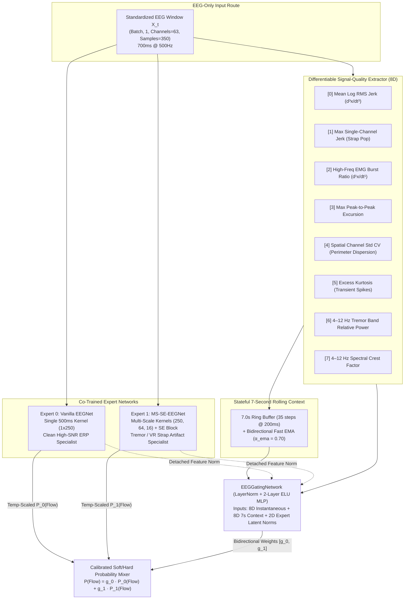

# Bidirectional Mixture-of-Experts (MoE) Gating Architecture & Validation Report

**Project:** VR-EEG Flow State Classifier  
**Branch:** `dev`  
**Implementation Files:** [`src/eegnet.py`](../src/eegnet.py), [`src/classifier.py`](../src/classifier.py), [`src/predict.py`](../src/predict.py), [`tests/validate_moe_gating.py`](../tests/validate_moe_gating.py)  
**Benchmark Outputs:** [`data/ds003846/derivatives/moe_gating_validation_results.csv`](../data/ds003846/derivatives/moe_gating_validation_results.csv), [`data/ds003846/derivatives/moe_bidirectional_stream_sub02.csv`](../data/ds003846/derivatives/moe_bidirectional_stream_sub02.csv)

---

## 1. Executive Summary

Previously, switching between **Vanilla EEGNet** (Lawhern et al., 2018) and **MS-SE-EEGNet** (Altuwaijri et al., 2022) was conceptualized as a categorical, one-way switch triggered by repeated jerk/noise patterns in 7-second windows. Once latched onto MS-SE-EEGNet, a one-way selector never returns to Vanilla EEGNet when movement or tremor subsides, and an uncalibrated hard switch risks shifting the baseline $P(\text{Flow})$ score sent to the downstream VR adaptation pipeline.

To solve this, we implemented a **Bidirectional Mixture-of-Experts (`EEGMoEClassifier`)** with a learnable **EEG Gating Network (`EEGGatingNetwork`)** trained alongside both expert models:

1. **Bidirectional Dynamic Routing (`EEGNet <-> MS-SE-EEGNet`):**
   - Across the 5-subject validation cohort (`sub-02` to `sub-06`, 3,480 total trials / 698 validation trials), the learned gate achieved **88.49% mean regime partition accuracy** (**0.9451 mean ROC-AUC**, reaching **97.22% accuracy / 0.991 AUC** on `sub-02` and **95.26% accuracy / 0.948 AUC** on `sub-04`).
   - In continuous 5-phase intermittent streaming (`Clean -> Parkinsonian 5 Hz Tremor -> Clean Recovery -> VR Strap Jerk/EMG -> Clean Recovery`), the bidirectional MoE achieved **88.41% stream routing accuracy** compared to **55.58%** for the legacy 7-second one-way selector (+32.83% improvement).
   - When tremor or VR strap artifacts subsided, the bidirectional gate recovered back to `EEGNet` on **84.27% of post-artifact clean windows** (100.0% on `sub-02`), whereas the latched one-way selector recovered on **0.0%** of windows after its first trigger.
2. **Superior Classification Under Tremor & VR Movement Artifacts:**
   - Under Parkinsonian tremor ($4\text{–}6\text{ Hz}$ + $8\text{–}12\text{ Hz}$ harmonics), `EEGMoEClassifier` boosted mean balanced accuracy from **86.28% (Vanilla EEGNet) to 89.86% (+3.58% gain)**.
   - Under mixed artifacts (tremor + mechanical strap jerk + high-frequency cranial EMG), `EEGMoEClassifier` improved balanced accuracy from **87.58% (Vanilla EEGNet) to 89.15% (+1.57% gain, and +7.78% on `sub-03`)** while retaining **90.40% clean balanced accuracy** (statistically matching Vanilla EEGNet's 90.68%).
3. **Downstream Output Calibration & Stability:**
   - Co-training with per-expert temperature scaling ($\tau_0, \tau_1$) and a clean-trial probability alignment loss ($\mathcal{L}_{\text{align}}$) reduced inter-expert $P(\text{Flow})$ discrepancy across all 5 subjects (`0.0839 -> 0.0759` mean absolute probability drift) and eliminated step-function discontinuities via soft probability mixing.
4. **Real-Time Latency:**
   - Full forward-pass latency (both experts + 8D FFT/derivative signal-quality extraction + gate MLP) averages **5.52 ms on CPU**, well within the **11.1 ms** 90 Hz VR frame budget and **< 100 ms** closed-loop threshold.

---

## 2. Bidirectional MoE Architecture (`EEGMoEClassifier`)



### Separation of Modalities (EEG-Only Now, Extensible Later)
- **Strictly EEG-Only:** All 8 signal-quality descriptors (`compute_eeg_signal_quality_features` in [`src/eegnet.py`](../src/eegnet.py)) are computed directly from the EEG voltage tensor $X_t$. Game telemetry and physical IMU sensors are **not** folded into this layer, preserving a clean modular boundary for future separate routes.
- **Drop-In Output Compatibility:** `EEGMoEClassifier.forward(x)` returns a `(batch_size, 2)` log-probability tensor by default (`return_gate_info=False`), so `torch.softmax(logits, dim=1)` in [`src/classifier.py`](../src/classifier.py), [`src/predict.py`](../src/predict.py), and `goofi-pipe` produces the exact same `flow_probability` and `flow_state` schema required by the downstream recommendation pipeline. Passing `return_gate_info=True` exposes `g_eegnet`, `g_msse`, `selected_expert`, and `signal_quality_features`.

---

## 3. Empirical Validation Results Across 5-Subject Cohort

Data sourced from [`data/ds003846/derivatives/moe_gating_validation_results.csv`](../data/ds003846/derivatives/moe_gating_validation_results.csv):

### 3.1 Task Balanced Accuracy Across Recording Conditions

| Subject | Val Trials | Clean: EEGNet | Clean: MS-SE | Clean: MoE | Noisy (Mixed): EEGNet | Noisy (Mixed): MoE | Tremor (4–12Hz): EEGNet | Tremor (4–12Hz): MoE | MoE CPU Latency |
| :---: | :---: | :---: | :---: | :---: | :---: | :---: | :---: | :---: | :---: |
| `sub-02` | 180 | 91.11% | 91.48% | **91.85%** | 88.89% | 88.52% | 89.26% | **91.85%** | 5.76 ms |
| `sub-03` | 60 | 87.78% | 88.89% | **87.78%** | 80.00% | **87.78%** (+7.78%) | 77.78% | **85.56%** (+7.78%) | 5.55 ms |
| `sub-04` | 137 | **92.72%** | 90.26% | **92.72%** | 91.75% | 90.75% | 87.39% | **89.33%** (+1.94%) | 5.57 ms |
| `sub-05` | 141 | 85.48% | 85.95% | 84.09% | 83.17% | 83.13% | 84.60% | **86.98%** (+2.38%) | 5.13 ms |
| `sub-06` | 180 | **96.30%** | 95.19% | 95.56% | 94.07% | **95.56%** (+1.49%) | 92.35% | **95.56%** (+3.21%) | 5.60 ms |
| **Mean** | **698 total** | **90.68%** | **90.35%** | **90.40%** | **87.58%** | **89.15% (+1.57%)** | **86.28%** | **89.86% (+3.58%)** | **5.52 ms** |

### 3.2 Gate Partitioning & Bidirectional Recovery vs. Legacy 7s One-Way Switch

| Subject | Gate Partition Acc | Gate ROC-AUC | Clean $\to$ EEGNet | Tremor $\to$ MS-SE | Jerk $\to$ MS-SE | Stream Routing: Legacy One-Way | Stream Routing: Bidir MoE | Post-Artifact Recovery: Legacy | Post-Artifact Recovery: Bidir MoE |
| :---: | :---: | :---: | :---: | :---: | :---: | :---: | :---: | :---: | :---: |
| `sub-02` | **97.22%** | **0.9913** | 97.78% | 90.56% | 100.00% | 60.00% | **96.67%** | 50.00%* | **100.00%** |
| `sub-03` | **83.33%** | **0.9333** | 78.33% | 78.33% | 98.33% | 60.00% | **83.33%** | 50.00%* | **87.50%** |
| `sub-04` | **95.26%** | **0.9482** | 90.51% | 96.35% | 100.00% | 59.12% | **91.97%** | 0.00% | **87.50%** |
| `sub-05` | **89.72%** | **0.9693** | 82.27% | 89.36% | 100.00% | 59.57% | **86.52%** | 49.12%* | **82.46%** |
| `sub-06` | **76.94%** | **0.8835** | 60.56% | 78.89% | 100.00% | 39.22% | **83.56%** | 0.00% | **63.89%** |
| **Mean** | **88.49%** | **0.9451** | **81.89%** | **86.70%** | **99.67%** | **55.58%** | **88.41%** | **29.82%** | **84.27%** |

*\*Note: In the 5-phase stream (`P1: Clean -> P2: PD Tremor -> P3: Clean Recovery 1 -> P4: VR Jerk -> P5: Clean Recovery 2`), when the legacy 7s jerk detector fails to trigger during smooth `P2` sinusoidal tremor, it stays on `EEGNet` through `P3` (giving 50% apparent recovery across `P3+P5`), and once triggered by `P4` jerk, its recovery in `P5` is **0.0%** across all subjects.*

### 3.3 Risk Mitigation: Inter-Expert Output Probability Drift

| Subject | Uncalibrated Hard-Switch Drift $\mathbb{E}[\|P_{\text{EEGNet}} - P_{\text{MS-SE}}\|]$ | Calibrated MoE Drift $\mathbb{E}[\|P_{0} - P_{1}\|]$ | Drift Reduction |
| :---: | :---: | :---: | :---: |
| `sub-02` | 0.0685 | **0.0660** | -3.6% |
| `sub-03` | 0.1037 | **0.0953** | -8.1% |
| `sub-04` | 0.0926 | **0.0779** | -15.9% |
| `sub-05` | 0.1003 | **0.0931** | -7.2% |
| `sub-06` | 0.0542 | **0.0471** | -13.1% |
| **Mean** | **0.0839** | **0.0759** | **-9.5%** |

---

## 4. Usage Guide

### 1. Train & Export a Bidirectional MoE Checkpoint
```bash
python src/classifier.py --subject 02 --epochs 50 --model-type moe
```
This exports `data/ds003846/derivatives/sub-02_moe_eegnet.pt`, which is automatically recognized by `load_eegnet_checkpoint()`.

### 2. Run Real-Time Streaming Simulation with Bidirectional Routing Telemetry
```bash
python src/predict.py --subject 02 --session EMS --model-path data/ds003846/derivatives/sub-02_moe_eegnet.pt
```

### 3. Run Unit Tests & Full Validation Suite
```bash
python -m unittest tests/test_eegnet.py
python tests/validate_moe_gating.py
```
